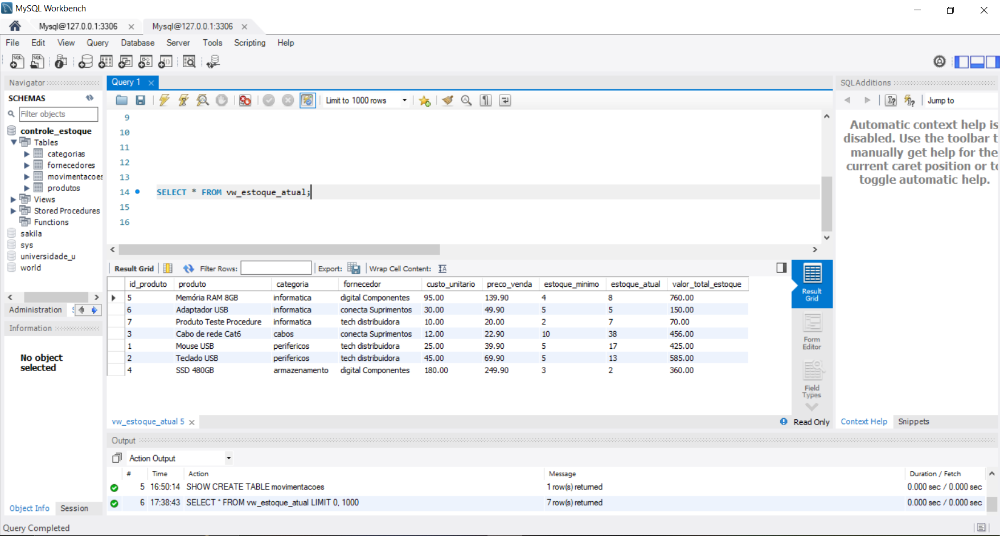
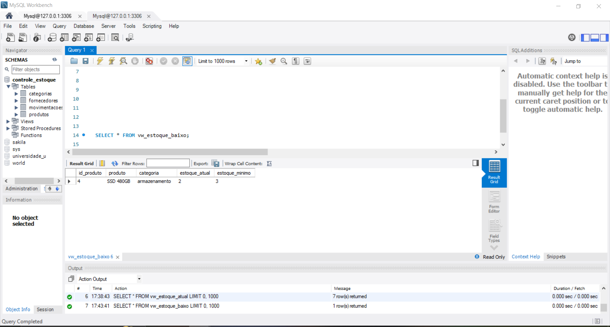
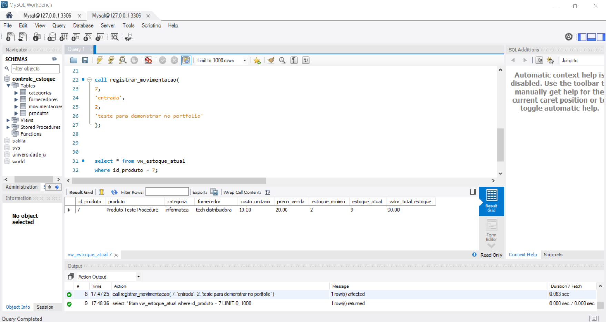

Controle de Estoque com MySQL

Sobre o projeto

Sistema de controle de estoque desenvolvido com MySQL para praticar SQL, modelagem de bancos de dados relacionais e criação de relatórios para pequenos negócios.

Tecnologias

- MySQL
- MySQL Workbench
- SQL

Funcionalidades

- Cadastro de produtos, categorias e fornecedores.
- Registro de entradas e saídas de estoque.
- Cálculo do estoque atual por meio das movimentações.
- Identificação de produtos abaixo do estoque mínimo.
- Relatórios de estoque e valores estimados de vendas.
- Views para reutilização de consultas.
- Stored procedure para registrar movimentações e bloquear saídas superiores ao estoque disponível.
- Indicadores de produtos e estoque.

Estrutura do banco de dados

O banco `controle_estoque` contém quatro tabelas principais:

- `categorias`
- `fornecedores`
- `produtos`
- `movimentacoes`

Conceitos SQL praticados

- CREATE DATABASE e CREATE TABLE
- INSERT e SELECT
- WHERE, GROUP BY e HAVING
- INNER JOIN e LEFT JOIN
- SUM, COUNT, CASE e COALESCE
- Chaves primárias e estrangeiras
- Restrições de integridade
- Views
- Stored procedures

Organização dos arquivos

A pasta `sql/` contém os scripts para criar as tabelas, inserir dados, executar consultas, criar views e criar a procedure.

Como executar o projeto

1. Instale o MySQL Server e o MySQL Workbench.
2. Execute `01_criar_tabelas.sql` em um banco de dados vazio.
3. Execute `02_inserir_dados.sql` para inserir os dados de exemplo.
4. Execute `04_views.sql` para criar as views de relatórios.
5. Execute `05_procedures.sql` para criar a procedure de movimentação de estoque.
6. Execute `03_consultas_relatorios.sql` para visualizar os relatórios e testar as consultas.

**Importante:** execute os scripts nessa ordem em um banco de dados de teste vazio. Não execute novamente o script de inserção em um banco que já contenha os dados, pois isso pode duplicar registros.

Diagrama do banco de dados

O diagrama apresenta as tabelas, chaves primárias, chaves estrangeiras e os relacionamentos do sistema.

[Visualizar diagrama do banco de dados](docs/diagrama_banco.md)

Evidências do projeto

Estoque atual

Relatório com os produtos cadastrados, quantidades disponíveis e valores em estoque.

Produtos com estoque baixo

Consulta que identifica os produtos abaixo do estoque mínimo definido.

Procedure de movimentação

Evidência do teste da procedure responsável por registrar movimentações de estoque.

Objetivo profissional

Projeto de estudo desenvolvido para demonstrar conhecimentos iniciais em bancos de dados relacionais e SQL, com foco em controle de estoque e relatórios gerenciais.

Autor

Projeto pessoal de portfólio.
