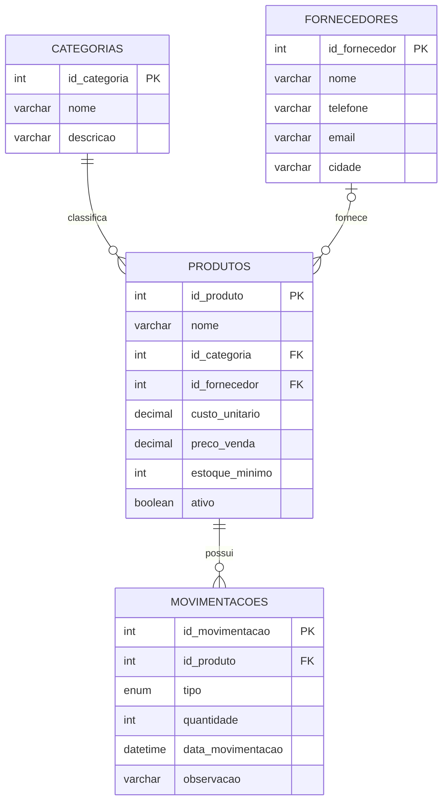

# Diagrama do Banco de Dados

Este diagrama apresenta as tabelas do projeto Controle de Estoque e seus relacionamentos.

## Relacionamentos

- **Categorias e produtos:** uma categoria pode ter vários produtos.
- **Fornecedores e produtos:** um fornecedor pode fornecer vários produtos; um produto pode não ter fornecedor associado.
- **Produtos e movimentações:** um produto pode ter várias movimentações de entrada e saída.

As siglas `PK` e `FK` representam, respectivamente, chave primária e chave estrangeira.
